<p align="center">
  
</p>

<h1 align="center">Zim Pro</h1>

**An offline AI knowledge base.** Zim Pro turns a folder of [ZIM](https://openzim.org) files
(offline Wikipedia, Stack Exchange, DevDocs, iFixit and the rest of the
[Kiwix catalog](https://library.kiwix.org)) into a library you can read, search and question,
on your own machine.

<a href="https://self-hosted.directory" target="_blank" rel="noopener noreferrer">
  
</a>


- **Knowledge that stays with you.** The books live on your disk and are read, searched and
  kept up to date by your own server.
- **AI that answers from them.** Ask a question and the answer is written from your books,
  with citations you can open and the pictures and videos from the pages it used.
- **Fully offline when you want it.** Point it at a local model (Ollama, LM Studio,
  llama.cpp) and nothing leaves your network: no internet is needed to read, search or ask.
  Hosted models and web search are there if you choose them, and the internet is otherwise
  only used to download and update books.
- **A knowledge source for your other AI tools.** The same library is served over MCP, so
  Claude and other LLM apps can search and read it.

It replaces `kiwix-serve`.

## Screenshots

<p align="center">
  <a href="screenshots/ask.png">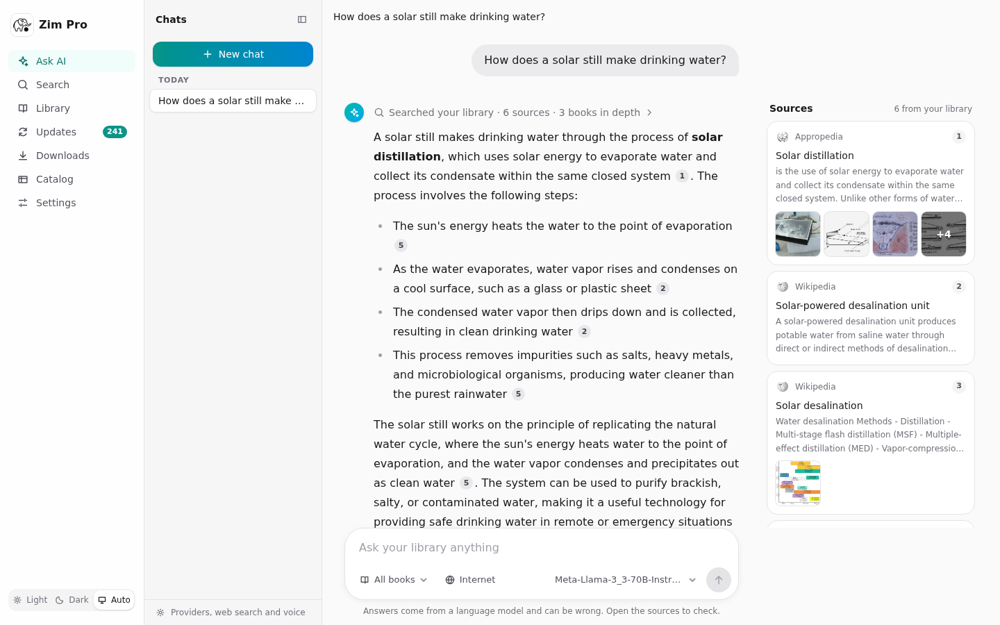</a>
  <br><sub>Ask AI: an answer written from your books, with citations and the sources beside it</sub>
</p>

<table>
  <tr>
    <td width="50%" valign="top"><a href="screenshots/ask-media.png">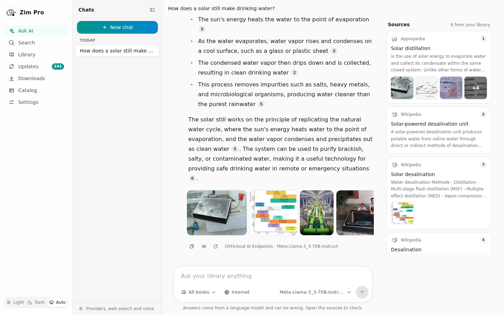</a><br><sub>Pictures and videos from the sources, under the answer</sub></td>
    <td width="50%" valign="top"><a href="screenshots/search.png">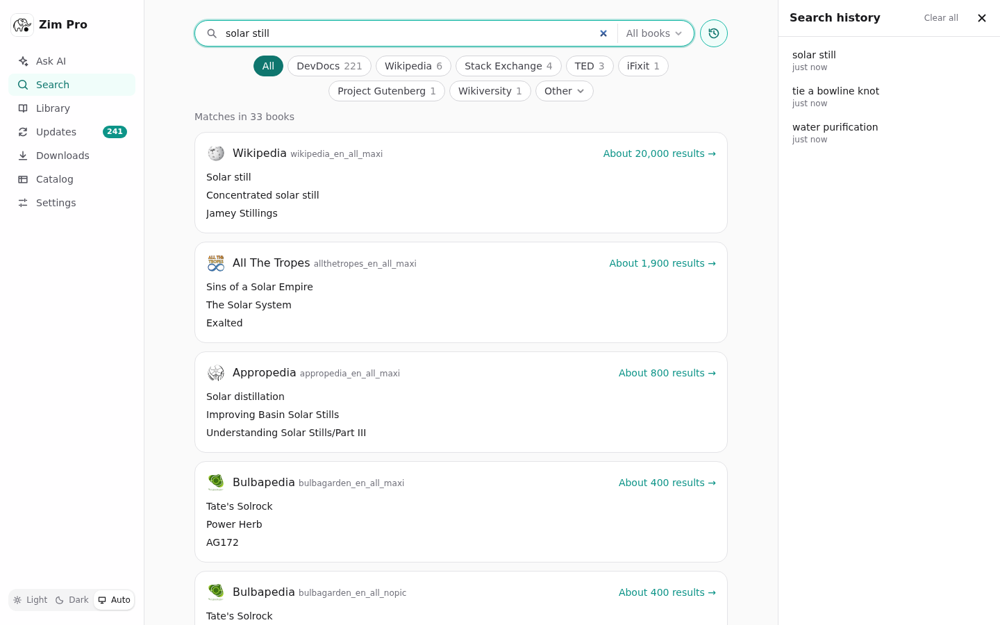</a><br><sub>Search across every book, with search history</sub></td>
  </tr>
  <tr>
    <td width="50%" valign="top"><a href="screenshots/library.png">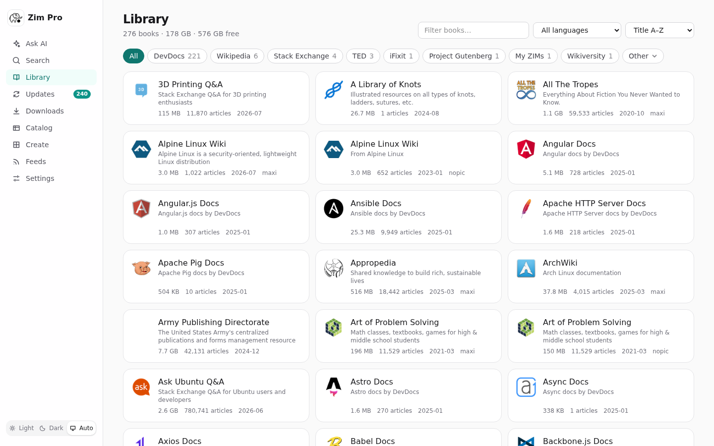</a><br><sub>The library</sub></td>
    <td width="50%" valign="top"><a href="screenshots/markdown.png">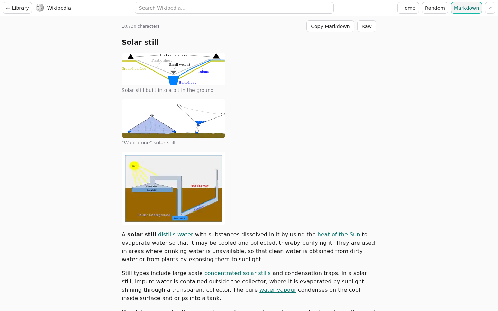</a><br><sub>Any article as Markdown, with its pictures</sub></td>
  </tr>
  <tr>
    <td width="50%" valign="top"><a href="screenshots/updates.png">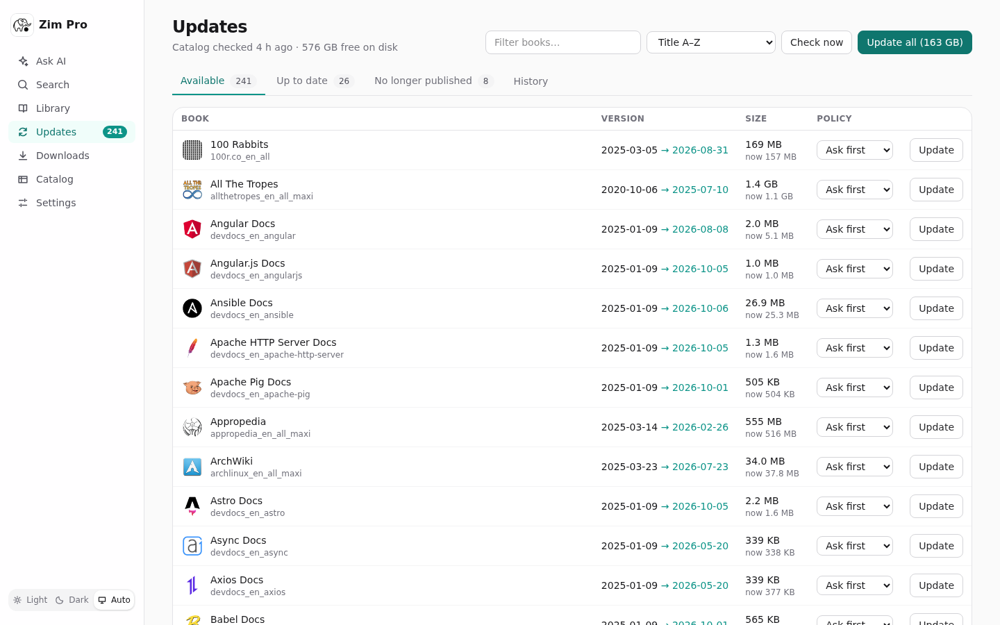</a><br><sub>Updates from the Kiwix catalog</sub></td>
    <td width="50%" valign="top"><a href="screenshots/settings.png">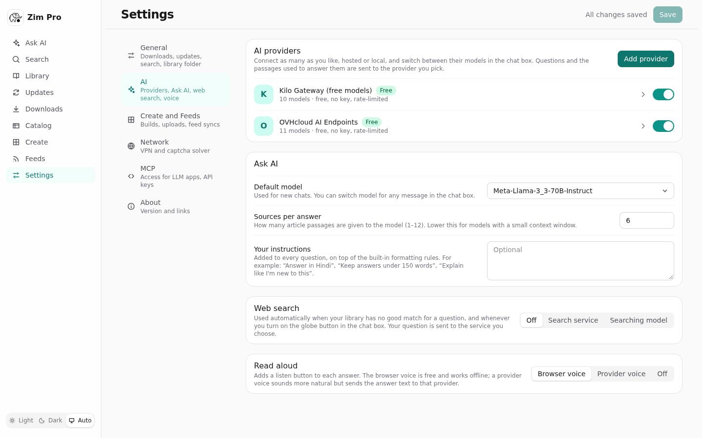</a><br><sub>Settings, in sections: AI, queues, monitoring, logs and more</sub></td>
  </tr>
  <tr>
    <td width="50%" valign="top"><a href="screenshots/create.png">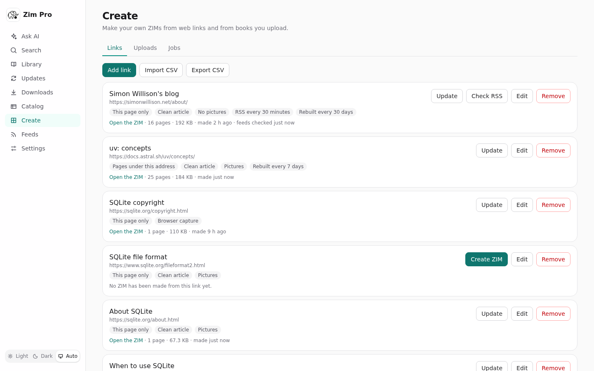</a><br><sub>Create: your own ZIMs from web links, each with its own schedule</sub></td>
    <td width="50%" valign="top"><a href="screenshots/create-link.png">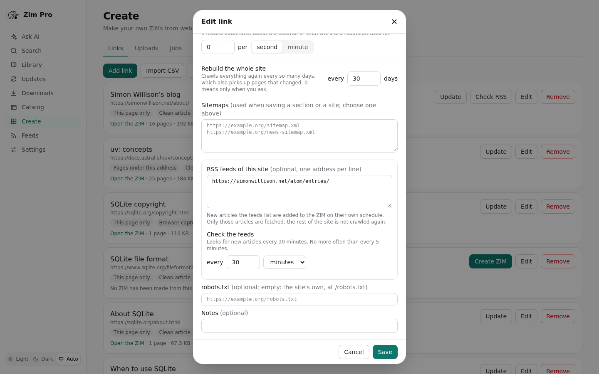</a><br><sub>A link's settings: rebuild schedule, sitemaps and RSS feeds</sub></td>
  </tr>
  <tr>
    <td width="50%" valign="top"><a href="screenshots/create-jobs.png">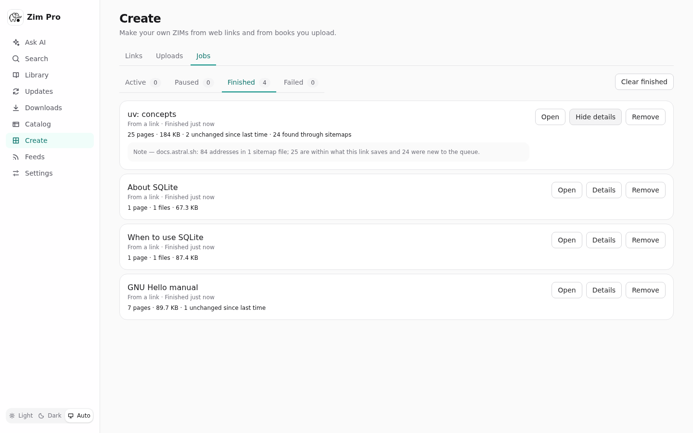</a><br><sub>Build jobs, with what each one saved</sub></td>
    <td width="50%" valign="top"><a href="screenshots/feeds.png">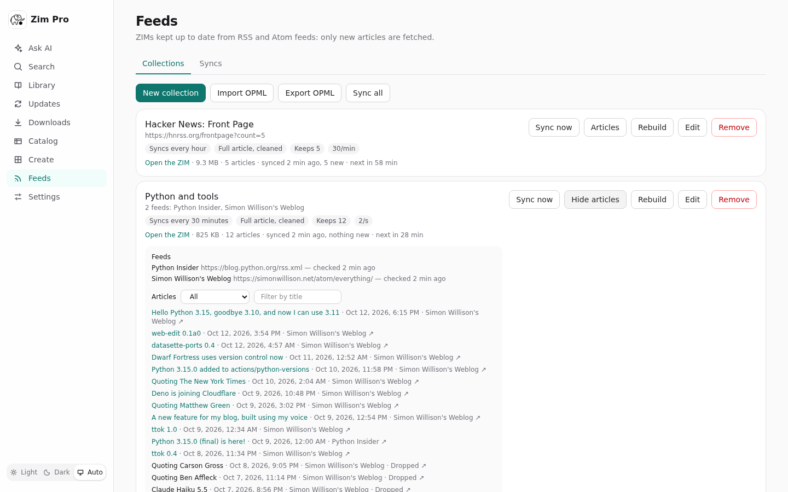</a><br><sub>Feeds: ZIMs kept up to date from RSS and Atom feeds</sub></td>
  </tr>
  <tr>
    <td width="50%" valign="top"><a href="screenshots/monitoring.png">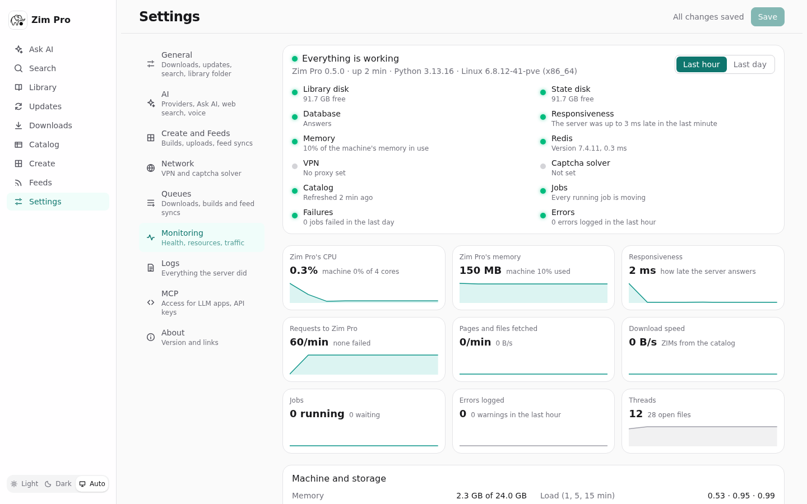</a><br><sub>Monitoring: health checks, resources and traffic</sub></td>
    <td width="50%" valign="top"></td>
  </tr>
</table>

<table>
  <tr>
    <td width="60%" valign="top"><a href="screenshots/ask-dark.png">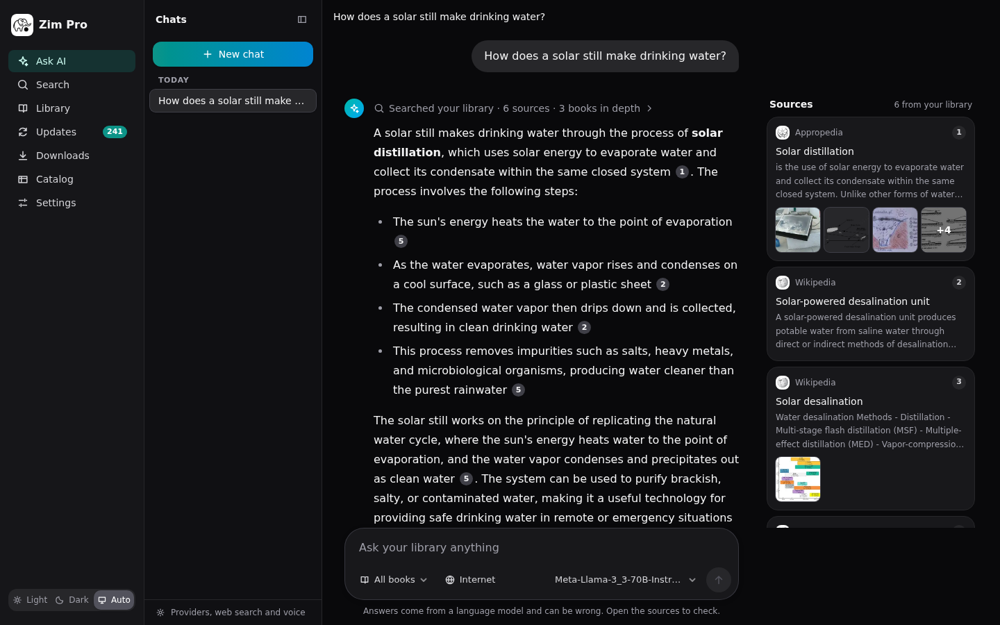</a><br><sub>The dark theme</sub></td>
    <td width="20%" valign="top"><a href="screenshots/phone-ask.png">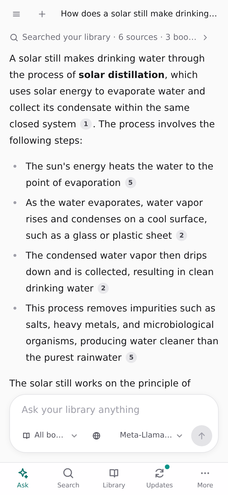</a><br><sub>On a phone</sub></td>
    <td width="20%" valign="top"><a href="screenshots/phone-library.png">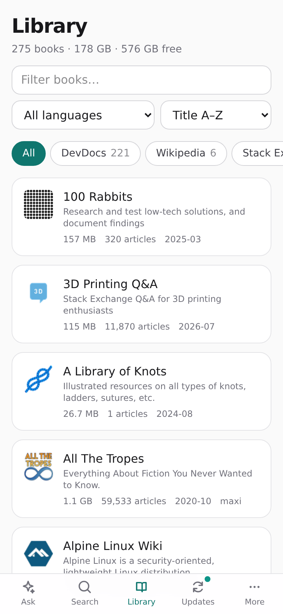</a><br><sub>Library on a phone</sub></td>
  </tr>
</table>

The screenshots are in [`screenshots/`](screenshots). The articles and pictures shown in them
come from Wikipedia and Appropedia, which publish them under Creative Commons licences. The
links and feeds shown on the Create and Feeds pages are public sites used as examples.

## What it does

- **Read** – a reader for every book, with in-book search and title suggestions. Entries are
  served at `/content/<book>/<path>` as `kiwix-serve` does, including `Range` for video.
- **Search** – full text within a book, or across the whole library with results grouped by
  book, with a history of past searches.
- **Ask AI** – ask a question and get an answer written from your books, with numbered
  citations, the source passages beside it, and the pictures and videos from those pages.
  Works with any OpenAI-compatible chat API, hosted or local, and with two free providers
  out of the box.
- **Markdown** – `/markdown/<book>/<path>` gives any article as Markdown: its text and
  pictures, with links leading to the Markdown of other articles. The reader's **Markdown**
  button shows it in place, with a copy button; videos and recordings play there too.
- **Updates** – compares each book with the Kiwix catalog and lists newer releases, with a
  policy per book: automatic, ask first, or pinned.
- **Downloads** – multi-connection across the Kiwix mirrors, SHA-1 checked per 4 MiB piece
  and SHA-256 checked at the end. Resumes after a pause, a restart or a crash.
- **Catalog** – browse the whole Kiwix library and add books.
- **Create** – make your own ZIMs: from web links (one page, a section or a whole site), and
  from PDF, EPUB and Kindle books you upload. They are read, searched and cited by Ask AI
  like any other book.
- **Feeds** – ZIMs kept up to date from RSS and Atom feeds: several feeds in one ZIM, synced
  on a schedule, fetching only the articles that are new.
- **MCP** – the library as tools for Claude and other LLM apps: streamable HTTP at `/mcp`,
  or stdio with `zim-pro mcp`.
- **Phone-friendly** – installable as a web app, with a layout made for small screens.

## Run with Docker

The image is published at `ghcr.io/magicstack-llp/zim-pro` for amd64 and arm64. It needs two
folders: your ZIM files, mounted at `/data`, and a folder for its database, mounted at
`/state`. The container runs as the user you give it, who must be able to write to both
(to `/data` because that is where downloads and updates go).

### docker run

```sh
mkdir -p zims state              # create them yourself, or Docker creates them as root
docker run -d --name zim-pro \
  --restart unless-stopped \
  --user "$(id -u):$(id -g)" \
  -p 8083:8080 \
  -v "$PWD/zims:/data" \
  -v "$PWD/state:/state" \
  --add-host host.docker.internal:host-gateway \
  ghcr.io/magicstack-llp/zim-pro:latest
```

Then open http://localhost:8083. `--add-host` is only needed for Ask AI to reach a model
server on the same machine (Ollama, LM Studio, llama.cpp).

### docker compose

```yaml
services:
  zim-pro:
    image: ghcr.io/magicstack-llp/zim-pro:latest
    container_name: zim-pro
    restart: unless-stopped
    user: "1000:1000"                # your own uid:gid, from `id -u` and `id -g`
    ports:
      - "8083:8080"
    extra_hosts:
      - "host.docker.internal:host-gateway"
    volumes:
      - ./zims:/data                 # your folder of .zim files
      - ./state:/state
    # environment:
    #   KIWIX_ADMIN_TOKEN: change-me # required for changes and /mcp when set
```

```sh
mkdir -p zims state
docker compose up -d
```

#### Ready-made files

The [`docker/`](docker) folder has complete compose files for each setup, with their
values in one `.env` file. Copy the folder, pick a file, and start it:

| File | What you get |
|---|---|
| [`compose.yml`](docker/compose.yml) | Zim Pro on its own |
| [`compose.solver.yml`](docker/compose.solver.yml) | + captcha solver (FlareSolverr) |
| [`compose.vpn.yml`](docker/compose.vpn.yml) | + VPN (Gluetun) for links and feeds, with the solver inside it |
| [`compose.vpn-external.yml`](docker/compose.vpn-external.yml) | Uses a Gluetun you already run elsewhere |
| [`compose.vpn-all.yml`](docker/compose.vpn-all.yml) | All of Zim Pro's traffic through the VPN |
| [`compose.zimit.yml`](docker/compose.zimit.yml) | + browser capture (Zimit) |
| [`compose.redis.yml`](docker/compose.redis.yml) | + Redis for the queues and a stream of the logs |
| [`compose.full.yml`](docker/compose.full.yml) | VPN, solver, browser capture and Redis together |

```sh
cd docker
cp .env.example .env             # then edit it
mkdir -p zims state
docker compose -f compose.vpn.yml up -d
```

[`docker/README.md`](docker/README.md) says which to choose.

#### Full example: with a VPN, a captcha solver and browser capture

Everything Zim Pro can use, in one file. Only the `zim-pro` service is required: delete
the parts you do not want. The comments say which setting each part goes with, and
[Sites that block or check visitors](#sites-that-block-or-check-visitors-captcha-solver-and-vpn)
and [Browser capture](#browser-capture-zimit) explain them.

```yaml
services:
  zim-pro:
    image: ghcr.io/magicstack-llp/zim-pro:latest
    container_name: zim-pro
    restart: unless-stopped
    user: "1000:1000"                # your own uid:gid, from `id -u` and `id -g`
    ports:
      - "8083:8080"
    extra_hosts:
      # Lets Ask AI reach a model server on this machine (Ollama, LM Studio, llama.cpp)
      # at http://host.docker.internal:<port>/v1
      - "host.docker.internal:host-gateway"
    environment:
      KIWIX_ADMIN_TOKEN: change-me   # optional: required for changes and /mcp when set
    volumes:
      - ./zims:/data                 # your folder of .zim files
      - ./state:/state               # the database, uploads and pictures
      # Browser capture (Zimit) only. This gives the container control of Docker on this
      # machine, so leave these two parts out unless you need it.
      - /var/run/docker.sock:/var/run/docker.sock
    group_add:
      - "999"                        # the docker group's gid: getent group docker
    depends_on:
      - gluetun
    # --- Network, when Gluetun is used -----------------------------------------------------
    # Gluetun started from THIS file: nothing to add. Zim Pro reaches it by name
    # (http://gluetun:8888) and only the pages for links and feeds go through the VPN.
    #
    # Gluetun started somewhere else (another compose file, or `docker run`): Zim Pro must
    # join the network Gluetun is on, or the name `gluetun` does not resolve. Find it with
    #   docker inspect gluetun -f '{{range $k, $v := .NetworkSettings.Networks}}{{$k}} {{end}}'
    # then uncomment these lines and the `networks:` block at the foot of this file.
    # networks:
    #   - default
    #   - vpn
    #
    # To send EVERYTHING Zim Pro does through the VPN (catalog, ZIM downloads, Ask AI too),
    # uncomment the line below instead. Then also: move `ports:` from this service to the
    # gluetun service, remove `extra_hosts:` here, and use http://localhost:8000 and
    # http://localhost:8191 in Settings (leave Proxy address empty). The web interface is
    # then unreachable whenever the VPN container is down.
    # network_mode: "service:gluetun"

  # VPN: pages for links and feeds are fetched through it. The web interface, the catalog
  # and ZIM downloads keep using your own connection.
  #   Settings -> Network -> Proxy address          = http://gluetun:8888
  #   Settings -> Network -> Control server address = http://gluetun:8000
  #   Settings -> Network -> Control server API key = the key set below
  gluetun:
    image: qmcgaw/gluetun:latest
    container_name: gluetun
    restart: unless-stopped
    cap_add:
      - NET_ADMIN
    devices:
      - /dev/net/tun:/dev/net/tun
    environment:
      # Your provider's details: https://github.com/qdm12/gluetun-wiki
      VPN_SERVICE_PROVIDER: mullvad
      VPN_TYPE: wireguard
      WIREGUARD_PRIVATE_KEY: change-me
      WIREGUARD_ADDRESSES: 10.64.0.2/32
      SERVER_COUNTRIES: Netherlands  # a country, not one server, so the address can change
      HTTPPROXY: "on"                # the proxy Zim Pro uses, on port 8888
      # The control server, on port 8000, and the key Zim Pro must send to it.
      # Make a long random one: openssl rand -hex 24
      HTTP_CONTROL_SERVER_AUTH_DEFAULT_ROLE: '{"auth":"apikey","apikey":"change-me"}'
      TZ: Etc/UTC

  # Captcha solver: gets past "checking your browser" pages. It runs inside the VPN's
  # network, so it leaves from the same address as Zim Pro's requests.
  #   Settings -> Network -> Solver address = http://gluetun:8191
  flaresolverr:
    image: ghcr.io/flaresolverr/flaresolverr:latest
    container_name: flaresolverr
    restart: unless-stopped
    network_mode: "service:gluetun"
    depends_on:
      - gluetun
    environment:
      LOG_LEVEL: info
      TZ: Etc/UTC

# The network Gluetun is on, when it is not started from this file (see "Network" above).
# networks:
#   vpn:
#     external: true
#     name: gluetun_default        # the name `docker inspect` gave
```

Without the VPN: remove the `gluetun` service and the `depends_on` that names it, remove
`network_mode` and `depends_on` from `flaresolverr`, and set **Solver address** to
`http://flaresolverr:8191`.

**If Gluetun already runs somewhere else** (its own compose file, or `docker run`): leave
the `gluetun` and `flaresolverr` services out of this file, remove `depends_on`, and
uncomment the two `networks:` blocks, so that Zim Pro joins the network Gluetun is on.
Without that, **Test connection** answers that `gluetun` cannot be found. Keep `default`
in the list: it is what the container uses for everything else.

Then fill in **Settings → Network** and press **Test connection** there. Nothing leaves
through the VPN or the solver until their addresses are saved in Settings.

### Everyday commands

| To | docker compose | docker run |
|---|---|---|
| See the logs | `docker compose logs -f` | `docker logs -f zim-pro` |
| Stop | `docker compose stop` | `docker stop zim-pro` |
| Start again | `docker compose start` | `docker start zim-pro` |
| Update to the newest image | `docker compose pull && docker compose up -d` | `docker pull ghcr.io/magicstack-llp/zim-pro:latest`, then `docker rm -f zim-pro` and the `docker run` above |
| Remove the container | `docker compose down` | `docker rm -f zim-pro` |

Removing the container loses nothing: the books are in `zims` and the settings, chats and
download progress are in `state`. A download in progress when the container stops carries on
from where it was when it starts again.

To stay on one version, use a version tag in place of `latest`, such as `:0.5.0` or `:0.5`.

### Build the image yourself

The `compose.yml` in this repository builds the image from source. It is the full setup
(VPN, captcha solver and browser capture), so it needs the VPN values in `.env`; see
[`docker/.env.example`](docker/.env.example). To build and run Zim Pro alone:

```sh
mkdir -p zims state
docker compose up -d --build --no-deps zim-pro     # http://localhost:8083
```

It mounts `/mnt/storage/Media/Kiwix/data` as the library; change that path to your own
folder of ZIM files.

## Run without Docker

Each [release](https://github.com/magicstack-llp/zim-pro/releases) has two other ways to run
it, with the web app included in both.

**Standalone executable** for Linux (x86-64 and arm64). One file, no Python needed:

```sh
tar -xzf zim-pro-0.5.0-linux-x86_64.tar.gz
cd zim-pro-0.5.0-linux-x86_64
KIWIX_DATA_DIR=/path/to/zims KIWIX_STATE_DIR=./state ./zim-pro   # http://localhost:8080
```

**Python package**, for Python 3.13 on Linux or macOS:

```sh
pip install zim-pro              # or: uvx zim-pro
KIWIX_DATA_DIR=/path/to/zims KIWIX_STATE_DIR=./state zim-pro   # http://localhost:8080
```

`SHA256SUMS` in the release lists the checksum of every file.

## Run from source

```sh
(cd web && npm ci && npm run build)
KIWIX_DATA_DIR=/path/to/zims KIWIX_STATE_DIR=./state uv run zim-pro
```

For UI work, run `npm run dev` in `web/` (set `KIWIX_BACKEND` if the server is not on
`127.0.0.1:8080`).

## Configuration

| Variable | Default | Meaning |
|---|---|---|
| `KIWIX_DATA_DIR` | `/data` | Folder of `.zim` files (scanned recursively) |
| `KIWIX_STATE_DIR` | `/state` | Where the SQLite database lives |
| `KIWIX_HOST` / `KIWIX_PORT` | `0.0.0.0` / `8080` | Listen address |
| `KIWIX_ADMIN_TOKEN` | unset | If set, changes need `Authorization: Bearer <token>`, and `/mcp` needs the token or an API key made in Settings |
| `KIWIX_CATALOG_URL` | Kiwix OPDS feed | Catalog to check for updates |
| `KIWIX_REDIS_URL` | unset | A Redis server for the queues and a copy of the logs, such as `redis://redis:6379/0`; without it the queues are kept in the database |

Download limits, the update schedule and policies are set in the web UI under Settings.

The project was first called Kiwix Updater. The `KIWIX_*` variables and the database file
(`kiwix-updater.sqlite3`) keep that name so existing installs carry on unchanged, and the
`kiwix-updater` command still works alongside `zim-pro`.

## Create your own ZIMs

The **Create** page makes ZIM files that land in your library and work everywhere else in the
app, including Ask AI and MCP. Each build runs in the background as a job: queued, then
processing (fetching, converting, writing, checking), then finished or failed. A build can be
**paused** while it waits or works and **resumed** from where it stopped; paused builds have
their own tab on the Jobs list and give their place to the next build in the queue.

### From links

Add a web address, choose what to save, and press **Create ZIM**. Each link makes one ZIM;
**Update** fetches it again and replaces the old one. A link can also rebuild itself every
so many days.

| Option | Choices |
|---|---|
| What to save | This page, the pages under this address, or the whole site, with limits on pages and depth |
| Include subdomains | With "whole site": also save `blog.example.org`, `docs.example.org` and so on for `example.org` |
| How to capture | **Built-in** (fast, small, no JavaScript) or **Browser (Zimit)** for sites that only render in a browser |
| Page content | **Clean article** (the article without menus, ads and scripts) or **Full page** (the page and its styles) |
| Pictures | Included, or replaced by their descriptions |
| Video and audio | Included, or left as a link to the original (off by default: they are large) |
| Rate limit | The most requests to the site per second or per minute. 0 is automatic: about 8 a second, or the `Crawl-delay` in the site's `robots.txt` |
| Sitemaps | One or more sitemap addresses to read, one per line. Empty: they are looked for (see below) |
| robots.txt | The address of the rules to obey, if they are not at the site's `/robots.txt` |
| RSS feeds | The site's own RSS or Atom feeds, one per line, with a schedule of their own (see below) |

Many links at once: **Import CSV**. Only a `url` column is required; `title`, `scope`
(`page`, `path`, `site`), `subdomains`, `engine` (`builtin`, `zimit`), `mode` (`clean`,
`full`), `images`, `video` (`yes`, `no`), `max_pages`, `sitemaps` (addresses separated by
spaces), `robots_url`, `rate_limit`, `rate_unit` (`second`, `minute`), `feeds` and `feed_minutes` are optional. The
file is checked first and shows which rows are new, already there, or unreadable, and nothing is added until you confirm. **Export
CSV** writes the same format back.

```csv
url,title,scope,images
https://example.org/guide/,Example guide,path,yes
https://example.org/faq.html,,page,no
```

The built-in crawler asks a site what it wants before fetching its pages:

- **`robots.txt` first.** It says what may be fetched, and how fast (`Crawl-delay`), and both
  are obeyed. Each subdomain has its own.
- **Sitemaps next.** The ones `robots.txt` names are read; if it names none, the usual places
  are tried (`/sitemap.xml`, `/sitemap_index.xml`, `/wp-sitemap.xml`, a sitemap beside the
  section you asked for, and others), including sitemap indexes, gzipped and plain-text ones.
  This finds pages that no other page links to.
- **One queue, each page once.** Pages from sitemaps and pages found by following links go
  through the same queue. An address is only ever queued once, however it is spelled: with
  or without `www`, `http` or `https`, a `#fragment`, or tracking parameters.
- **"Too many requests" is respected.** When a site answers HTTP 429 (or 503 with
  `Retry-After`), the crawler waits as long as the site asks, or 5 seconds doubling each
  time if it does not say, then tries that page again and fetches more slowly from that
  site for the rest of the build. The job shows that it is waiting. A page is only given up
  on, and listed as failed, if the site still refuses after six waits.
- A cache per link means an update only downloads what changed.

**Keeping a site current without crawling it again.** A link has two schedules:

- **Rebuild the whole site** every N days crawls everything again. It is the only way to
  pick up pages that changed, and it is slow for a big site.
- **RSS feeds**, checked every so many minutes, hours or days (no more often than every 5
  minutes). When the site's feeds list an article that is not in the ZIM yet, only that
  article and its pictures are fetched; every page saved before is taken from the cache on
  disk and the ZIM is written again with the new article in it. If the feeds list nothing
  new, nothing is written. **Check RSS** on a link does the same on request.

Articles that came in through a feed stay in the ZIM when the whole site is rebuilt, even
after they have dropped off the end of the feed. To follow feeds from several sites in one
ZIM, without saving a site, use the Feeds page.

What you save and how you use it is your responsibility: check a site's terms before copying
it.

### From books

Drop a **PDF**, **EPUB**, **MOBI** or **AZW3** file on the Uploads tab. It is converted to
readable, searchable pages (an EPUB by chapter, a PDF by page) and the original file is kept
inside the ZIM, linked from its first page. A **ZIM** file is checked and added as it is.

- A PDF keeps a picture of each page beside its text unless you turn pictures off, so scanned
  pages and complex layouts lose nothing. A PDF with no text layer can be read but not
  searched; there is no OCR.
- Books protected by DRM cannot be converted.

### Categories and pictures

Every link, uploaded book and feed collection has a **Category** and a **Picture**.

- **Category** decides where the ZIM is filed: the categories you make show as filters in
  the Library, in Search and in Ask AI, beside Kiwix's own. The dropdown lists your own
  categories and the ones already in your library (Wikipedia, DevDocs and so on), so a ZIM
  you make can sit with the books Kiwix publishes. Pick one from the dropdown, add
  one on the spot with **+ New category…**, or press **Manage** to add, rename and remove
  them. Renaming a category moves everything filed under it; removing one sends its ZIMs
  back to **My ZIMs**. Changing a ZIM's category takes effect at once, without building it
  again. The CSV for links has a `category` column.
- **Picture** is the icon the ZIM is shown with. Left empty, a link uses the site's own icon
  (its touch icon if it has one, then its favicon, then the picture it gives for sharing),
  a book uses its cover, and a ZIM with none of those gets a tile with the first letter of
  its title. Choose a PNG, JPEG, WebP, GIF or ICO file to use your own; it goes into the ZIM
  the next time the ZIM is made. Browser captures (Zimit) and ZIM files you upload keep the
  picture they came with.

### How the ZIMs are made

Pages are fetched several at a time, cleaned and converted on worker threads, and compressed
and indexed on libzim's own threads (Settings → Create and Feeds sets how many). Before a ZIM enters the
library it is opened again and compared with what was prepared: the page count, every file,
and a sample of pages byte for byte. Each job keeps a list of anything that failed or was
skipped, with the reason. Only real pages are marked as articles and the full-text index is
built from their cleaned text, so search and Ask AI match what a reader sees. The files pass
openZIM's `zimcheck`.

### Browser capture (Zimit)

Zimit records pages in a real browser. It runs as a separate container, so Zim Pro needs
access to Docker to start it: mount the Docker socket and let the container's user use it.

```yaml
    volumes:
      - /var/run/docker.sock:/var/run/docker.sock
    group_add:
      - "999"          # the gid of the docker group on your host: getent group docker
```

**Mounting the Docker socket gives the container control of Docker on the host, which is
equivalent to root there.** Leave it out unless you need browser capture and trust what runs
in the container. Without it, the option is shown as unavailable and everything else works.
The first capture downloads the Zimit image (about 1.5 GB).

### Sites that block or check visitors: captcha solver and VPN

Two optional helper containers come with the compose files in [`docker/`](docker):
`compose.solver.yml` has the solver, `compose.vpn.yml` the VPN with the solver inside it.
They apply to pages
fetched by the built-in crawler and by Feeds, not to Zimit captures, the catalog or ZIM
downloads. Each has its own section in **Settings** (**VPN** and **Captcha solver**), with a
switch to turn it off without losing its addresses. Once set up, both also appear at the
foot of the menu: a status light each (green working, amber busy, red not answering,
grey off), the same switches, and an **i** that opens the details: the VPN's address,
country and network, and **Change IP**.

**Captcha solver ([FlareSolverr](https://github.com/FlareSolverr/FlareSolverr)).** Some sites
answer a plain request with a "checking your browser" page (Cloudflare's "Just a moment…",
DDoS-Guard). With a solver set, Zim Pro hands such a page to FlareSolverr, which opens it in
a real browser, and then carries on with the clearance it earned, so pictures and later
pages are fetched the normal way. Without one, such pages are listed as failed with a note
saying why.

- Start the `flaresolverr` service and set **Solver address** to
  `http://flaresolverr:8191`. Settings shows whether it answers, and its version.
- It gets past browser checks. It does **not** solve picture or checkbox captchas
  (reCAPTCHA, hCaptcha, Turnstile widgets), and a site can still refuse it.
- It is slow (a browser per page) and uses a few hundred MB of memory.

**VPN ([Gluetun](https://github.com/qdm12/gluetun)).** Gluetun connects to your VPN provider
and offers an HTTP proxy. Set **Proxy address** to `http://gluetun:8888` and every page
fetched for a link or a feed leaves through the VPN, while the web interface and everything
else keep using your own connection.

- Start the `gluetun` service and fill in your provider's details; the
  [Gluetun wiki](https://github.com/qdm12/gluetun-wiki) has them for each provider.
  `HTTPPROXY: "on"` must stay.
- **Using both:** a clearance is tied to the address that earned it, so the solver must
  leave through the same VPN. `docker/compose.vpn.yml` does this (the `flaresolverr` service has
  `network_mode: "service:gluetun"`); set **Solver address**
  to `http://gluetun:8191`.
- The proxy must be `http://` or `https://`; SOCKS is not supported.

**Test connection**, in both sections, tries the addresses as typed, before you save them.
For the VPN it asks the control server for its state and fetches a page through the proxy
(from cloudflare.com, which answers with the address it was asked from), then says whether
the two agree. For the solver it asks whether FlareSolverr is there and ready.

**Seeing and changing the VPN's address.** Gluetun has a control server on port 8000. Give
Zim Pro its address and Settings and the menu show whether the VPN is connected, the public
IP address it has, and its country, region and network.

- Set **Control server address** to `http://gluetun:8000`. The control server asks who is
  calling: the compose files set an API key with `HTTP_CONTROL_SERVER_AUTH_DEFAULT_ROLE`; put
  the same key in **Control server API key**. A name and password work too, if that is how
  your container is set up.
- **Change IP now**, in Settings (**Change IP** behind the **i** in the menu), stops the VPN and starts it again, which
  is how Gluetun picks another server. The new address is shown when it is up. Give Gluetun
  more than one server to choose from (a country, not a single host) or it will come back
  with the same address, and Zim Pro will say so.
- **Change IP when a site says too many requests** does this by itself during a build. A
  large site can refuse an address (HTTP 429) however politely it is asked; with the switch
  on, Zim Pro reconnects the VPN and asks for the page again from the new address, without
  the long wait. It changes address at most once a minute, so a site that refuses every
  address is still waited for in the ordinary way. While the VPN reconnects (a few
  seconds), everything that goes through it waits: other builds and feed syncs included.
- The keys and passwords are stored on the server and never sent back to the browser.

Getting past a site's checks does not change what you are allowed to copy: its terms still
apply.

## Feeds

The **Feeds** page keeps ZIMs up to date from RSS and Atom feeds. It is separate from the
Create page: its own engine, its own queue (so a long crawl never holds up the news), its
own schedule and its own settings.

A **collection** is one or more feed addresses kept as a single ZIM. Its first page lists
every article, newest first, by month.

- **Add feeds** by address, or type a site's address and press **Find feeds** to see the
  feeds it advertises. **Import OPML** brings in the feeds from another reader
  (Feedly, Inoreader, NetNewsWire, Miniflux, Thunderbird): drop the file in, see its folders
  and feeds (with the ones you already have marked), tick the folders you want, and choose
  one collection per folder or all in one, a category, and whether to sync straight away.
  **Export OPML** writes yours out.
- **Only new articles are fetched.** Each sync reads the feeds, downloads the articles it
  has not seen, and writes the ZIM again from what it already keeps on disk. If nothing is
  new, the ZIM is left alone.
- **Schedule** per collection: every so many minutes, hours or days (no more often than
  every 5 minutes), or only when you press **Sync now**.
- **Full article or feed text.** By default each article's page is opened and saved,
  cleaned like a link on the Create page. If the page cannot be had (gone, paywalled,
  blocked by `robots.txt`), what the feed itself carries is saved in its place. Turn "Fetch
  the full article" off to save only the feed's own text.
- **Articles to keep**: the newest N stay in the ZIM and older ones drop out; 0 keeps
  everything.
- **Pictures, video and audio, rate limit** as for links.
- **Articles** lists what a collection holds and what failed, with the reason; **Retry
  failed** asks for those again, and **Rebuild** writes the ZIM again from scratch.
- The **Syncs** tab is the queue: active, paused, finished and failed, with what each sync
  found. The last hundred are kept.

**Settings → Create and Feeds** has the master switch for scheduled syncing, how many syncs
run at once, and the defaults for new collections. The VPN and captcha solver under
Settings → Network apply to feeds too.

Feed ZIMs appear in the library under "My ZIMs" and are searched and cited by Ask AI like
any other book.

## Ask AI

Add one or more providers under Settings → AI, then pick a default model. Any
server with the OpenAI `/chat/completions` API works: OpenAI, Google Gemini, Perplexity,
OpenRouter, Groq, Ollama, LM Studio, llama.cpp, vLLM. The model can be switched per message
in the chat box.

Each provider has a switch: turned off, it is kept with its key but not used or offered.

Two providers that need no account or key are added on first start, so Ask AI works straight
after installing: **OVHcloud AI Endpoints** (Llama 3.3 70B, Qwen, Mistral, gpt-oss; about two
requests a minute per model) and **Kilo Gateway**'s free models (about 200 requests an hour;
Kilo may log free-tier prompts for training). Both are rate-limited per IP address and can be
removed under Settings; a removed one is not added back.

For a model server on the Docker host, use `http://host.docker.internal:<port>/v1` (Ollama:
`11434`, LM Studio: `1234`), not `localhost`, and make the server listen on all interfaces
(for Ollama, `OLLAMA_HOST=0.0.0.0`).

How a question is answered (see `src/zim_pro/retrieval.py`):

1. **Plan.** The model is shown the list of books and returns several short queries from
   different angles, extra keywords a good article would contain, and the books most likely
   to help. If it cannot be asked in time, the question's own words are used.
2. **Search the relevant books in depth** with every query and keyword. These are the model's
   picks, books named after the subject, and always the main encyclopedia.
3. **Search every other book lightly** with the main queries.
4. **Rank.** Articles found by several searches rise (reciprocal rank fusion); the best 24 are
   read and scored on how much of the subject one passage covers, and only passages that fit
   are sent to the model with the question.

Articles reach the model as Markdown (`library/article.py`), not HTML: navigation, pictures
and their captions, citation markers, reference lists, "See also" and "External links"
sections and licence footers are removed and links are flattened to their text, so the tokens
go on prose. Each passage is sent under the heading of the section it came from.

The pictures, videos and recordings on each source's page are listed with the source and
shown as thumbnails under it; they are not sent to the model.

Chats are stored in the database.

Every prompt carries formatting rules, and answers are passed through a repair step before
they are shown (unclosed code blocks, leaked reasoning, malformed lists, tables and citations),
since small models often get Markdown wrong. Your own standing instructions can be added
under Settings → AI.

**Web search** (off by default) is used when the library has no good match, or for every
question while the Internet button in the chat box is on. Either:

- a *search service* (Tavily, Brave, Serper for Google results, or your own SearXNG), whose
  results are added to the sources for your chat model, or
- a *searching model* that looks things up itself: Perplexity Sonar, OpenRouter's web add-on,
  an OpenAI search model, or Gemini with Google Search.

**Read aloud** adds a listen button to answers, using the browser's built-in voice or a
provider's speech model (OpenAI, Gemini, Groq, or a local `/audio/speech` server).

## Queues, monitoring and logs

Settings has three sections for seeing what the server is doing, and changing it.

**Queues** shows downloads, builds and feed syncs side by side. For each: what is running
(progress, how long, and when it last moved), what is waiting and in which order, what is
held, and what failed in the last day with the reason. You can pause and resume a whole
queue (running jobs finish, nothing new starts), change how many run at once, move a
waiting job to the top or bottom or one place up or down, retry everything that failed,
and cancel everything waiting. Figures for the last day: jobs done and failed, the average
wait and run time, how long 95% took, and an hour-by-hour chart.

The queues work with nothing more than the database. With `KIWIX_REDIS_URL` set, the order
of each queue and whether it is paused are kept in Redis instead: a sorted set
`zimpro:queue:<name>` (`downloads`, `builds`, `feeds`; the lowest score starts first) and a
key `zimpro:queue:<name>:paused`, which you can read and change with `redis-cli` or any
other tool; Zim Pro follows within five seconds. The database still keeps the record of
every job, so if Redis stops the queues carry on from it, and Redis is filled again when
it is back. [`docker/compose.redis.yml`](docker/compose.redis.yml) runs the two together.

**Monitoring** runs health checks (free disk space for the library and the state folder,
the database, how promptly the server answers, memory, Redis, the VPN, the captcha solver,
the catalog, jobs that have stopped moving, recent failures and errors) and charts the last
hour or day: CPU and memory of Zim Pro and the machine, responsiveness, requests to the
server, pages and files fetched, download speed, jobs, and errors logged. Tables show each
part of the API (requests, failures, average and 95th-percentile time), the sites builds
and feeds fetch from (with the last problem each one gave), and the AI providers. A job
that has not moved for ten minutes is flagged there and in the logs.

**Logs** gathers every line from every part of the server in one list: downloads, builds,
feeds, the network, AI, MCP, the queues, requests that failed or were slow, and the server
itself. Each line says which part wrote it and, when it was written for a job, which one
(`feed 12`, `download 3`): click the job to follow just it. Filter by level, part, job or
text; the list updates live. Lines are written to `logs/zim-pro.log` in the state folder
(five files of 5 MB are kept, one JSON object per line), read back after a restart, sent to
the Redis stream `zimpro:logs` when Redis is used, and can be downloaded. Keys, tokens and
passwords are blanked out before a line is kept. Choose how much is kept: errors only up to
every web request.

## MCP

```sh
claude mcp add --transport http zim-pro http://localhost:8083/mcp
```

Tools: `list_books`, `search`, `suggest`, `get_article`, `get_article_outline`,
`list_updates`, and `start_update` (off until enabled in Settings).

For a stdio client, run `zim-pro mcp` with `KIWIX_DATA_DIR` and `KIWIX_STATE_DIR` set.

**API keys.** With no key and no admin token, anyone who can reach the server can use
`/mcp`. To lock it, open **Settings → MCP** and press **Generate key**:

- The key (it starts with `zp_mcp_`) is shown once, with a button to copy it and the
  `claude mcp add` command already filled in. Clients send it as
  `Authorization: Bearer <key>`.
- Only a SHA-256 fingerprint of the key is stored, so neither the database nor a backup of
  it can give a key back. A lost key is replaced, not recovered.
- Each key has a name, the date it was made and when it was last used. **Revoke** stops it
  at once. Make one key per app, so one can be revoked without touching the others.
- As soon as one key exists, `/mcp` answers only to a key (or to `KIWIX_ADMIN_TOKEN`, if
  that is set). Revoking the last key opens it again.

The keys guard `/mcp` only. The web interface and its API are guarded by
`KIWIX_ADMIN_TOKEN`: without it, anyone who can open the web interface can also make keys,
so set the token if the server is reachable by people you do not trust.

```sh
claude mcp add --transport http zim-pro http://localhost:8083/mcp \
  --header "Authorization: Bearer zp_mcp_..."
```

## Notes

- Articles are served from the same origin as the admin UI, as with `kiwix-serve`. Scripts
  inside a ZIM could therefore call the API; set `KIWIX_ADMIN_TOKEN` if you load ZIMs you do
  not trust or expose the port beyond your LAN.
- libzim holds Python's GIL, so a slow full-text search briefly delays other requests.
- libzim does not expose relevance scores, so cross-book search groups results by book
  instead of ranking them together.

## Tests

```sh
uv run pytest
(cd web && npm test)
```

## Contributing

Bug reports, ideas and pull requests are welcome: see [CONTRIBUTING.md](CONTRIBUTING.md) for
how to set up, run the checks and send a change, and the [Code of Conduct](CODE_OF_CONDUCT.md).
Please report security problems privately, as [SECURITY.md](SECURITY.md) describes.

## Built with

Python 3.13, FastAPI and [python-libzim](https://github.com/openzim/python-libzim) on the
server, SQLite for state, and React, Vite and Tailwind for the web app. Zim Pro is an
independent project and is not affiliated with Kiwix.

## Releasing

Pushing a tag of the form `v1.2.3` runs `.github/workflows/release.yml`:

1. Lint and tests. Nothing is published if they fail.
2. In parallel: the Docker image for amd64 and for arm64 (each on its own runner, then joined
   and published to GHCR as `1.2.3`, `1.2` and `latest`), the Python wheel and source
   archive (then uploaded to PyPI), and the standalone executables.
3. Last, and only if all of those succeeded, the GitHub release, with the executables, the
   wheel, the source archive and their checksums attached.

The package version comes from the tag, and the release notes from that version's section of
`CHANGELOG.md`, so move the entries under "Unreleased" to a new version heading before
tagging.

```sh
git tag v0.5.0 && git push origin v0.5.0
```

Every push to `master` and every pull request runs `.github/workflows/ci.yml`: Python lint
(`ruff check`), formatting check and tests, and the web app's type check, tests and build.

## Licence

Copyright (C) 2026 Kuldip Satpute and Magicstack Enterprise LLP.

Zim Pro is free software: you can redistribute it and/or modify it under the terms of the
[GNU General Public License, version 3](LICENSE), as published by the Free Software
Foundation. It is distributed in the hope that it will be useful, but WITHOUT ANY
WARRANTY; without even the implied warranty of MERCHANTABILITY or FITNESS FOR A PARTICULAR
PURPOSE. See the licence for details.
